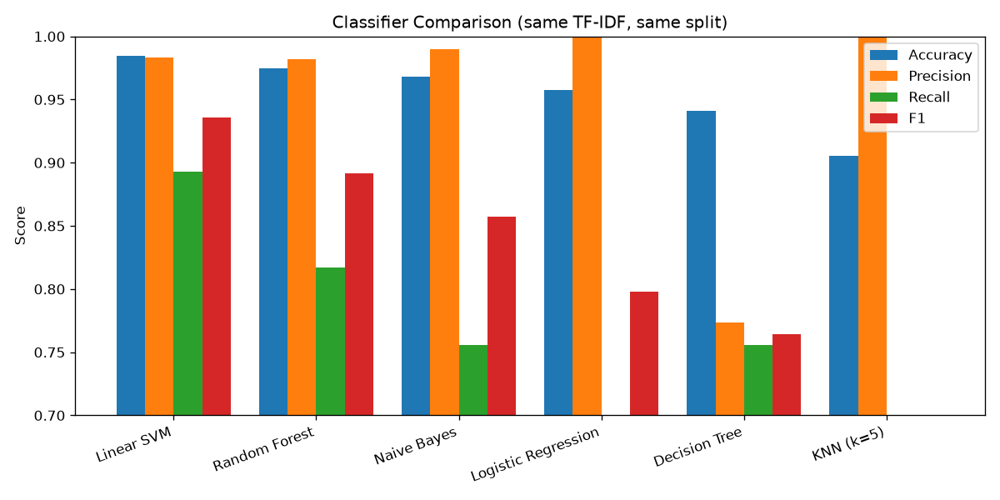

## Model Comparison

Same TF-IDF (5,000 features, 1–2 grams), same 80/20 stratified split, six classifiers compared:

| Model | Accuracy | Precision | Recall | F1 | Train (s) |
|---|---|---|---|---|---|
| Linear SVM | 0.9845 | 0.983 | 0.893 | **0.936** | 0.16 |
| Random Forest | 0.9749 | 0.982 | 0.817 | 0.892 | 0.79 |
| Naive Bayes | 0.9681 | 0.990 | 0.756 | 0.857 | 0.14 |
| Logistic Regression | 0.9574 | 1.000 | 0.664 | 0.798 | 0.18 |
| Decision Tree | 0.9410 | 0.773 | 0.756 | 0.764 | 0.37 |
| KNN (k=5) | 0.9052 | 1.000 | 0.252 | 0.402 | 0.15 |

### Why Linear SVM wins

Text data has ~5,000 features and the spam/ham boundary is roughly linear, which is
the sweet spot for a linear SVM. It also handles high-dimensional sparse inputs
well without overfitting.

### Why the others lose

- **KNN** fails because in high-dimensional TF-IDF space, all points become
  nearly equidistant (the *curse of dimensionality*). Its decision rule breaks down.
- **Decision Tree** overfits single-word splits. Random Forest fixes this via
  ensemble averaging and recovers most of the lost performance.
- **Logistic Regression** shows perfect precision (1.0) but poor recall (0.66) —
  it's too conservative at the default regularization and would need `C` tuning
  to compete.
- **Naive Bayes** assumes word independence, which is violated ("free" and "win"
  co-occur in spam), so it trails SVM by ~4 points of recall.